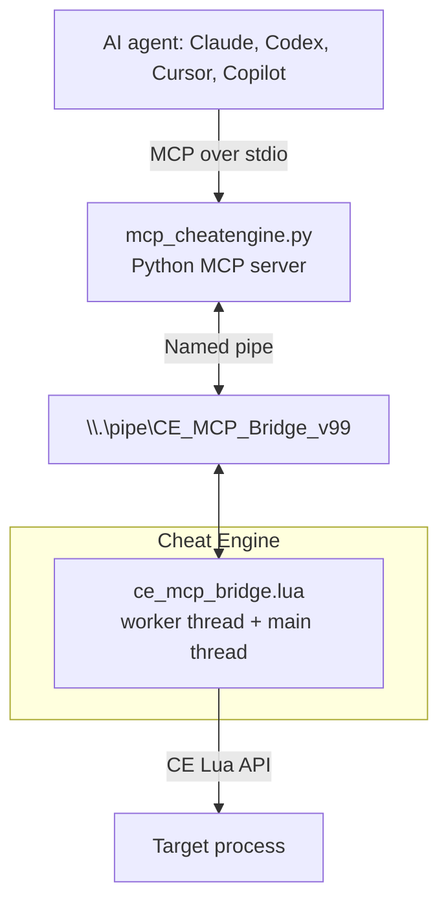

[Demo](https://github.com/user-attachments/assets/a184a006-f569-4b55-858a-ed80a7139035)

# Cheat Engine MCP Bridge

**Let an AI agent work with Cheat Engine for you.** Ask in plain language, and the agent reads memory, scans for
values, follows pointers, disassembles code and sets breakpoints through Cheat Engine.

Use it to build mods and trainers, study how a program works, or speed up reverse engineering.

[](#whats-new-in-this-fork)
[](#how-it-works)
[](https://py.sdk.modelcontextprotocol.io/)
[](https://python.org)
[](https://github.com/Invalidity/cheatengine-mcp-bridge/actions/workflows/offline-tests.yml)

> [!NOTE]
> This is a fork of [miscusi-peek/cheatengine-mcp-bridge](https://github.com/miscusi-peek/cheatengine-mcp-bridge).
> It runs on the current MCP Python SDK (2.x), includes several open upstream pull requests, and adds safety and
> reliability fixes. Credit for the original goes to [@miscusi-peek](https://github.com/miscusi-peek) and its
> contributors. See [What's new in this fork](#whats-new-in-this-fork).

---

## What you can ask

> *"Find the function that decrypts incoming packets."*
> *"Which instruction writes to my health value?"*
> *"Make an AOB signature that still works after the next game update."*
> *"What C++ class is the object at this address?"*

Your agent can:

- Read and write memory: integers, floats, strings, raw bytes and pointer chains
- Scan for values and byte patterns, then narrow the results
- Disassemble functions and find what calls or references them
- Identify C++ objects with RTTI and recover their structure layout
- Find pointer paths and keep only the ones that survive a game restart
- Set hardware breakpoints, or trace with DBVM without touching the target's code
- Run long scans in the background without freezing Cheat Engine

---

## How it works



There are three parts:

1. **Your AI client** starts the Python server and talks to it over MCP.
2. **The Python server** (`mcp_cheatengine.py`) turns each tool call into a command and sends it down a named pipe.
3. **The Lua bridge** (`ce_mcp_bridge.lua`) runs inside Cheat Engine, carries out the command and sends back the
   result.

---

## Quick start

### 1. Install

You need Windows, Cheat Engine 7.x and Python 3.10 or newer.

```bash
pip install -r MCP_Server/requirements.txt
```

This installs the MCP Python SDK 2.x and `pywin32`. If you used the original project before, this upgrades `mcp`
from 1.x. Use a virtual environment if other tools on your machine still need SDK 1.x.

### 2. Load the bridge in Cheat Engine

In Cheat Engine, choose **File → Execute Script**, open `MCP_Server/ce_mcp_bridge.lua` and click **Execute**.

If your build has no Execute Script item, open **Table → Show Cheat Table Lua Script** and run this line instead:

```lua
dofile([[C:\path\to\cheatengine-mcp-bridge\MCP_Server\ce_mcp_bridge.lua]])
```

When it works, Cheat Engine prints: `[MCP v12.0.0] MCP Server Listening on: CE_MCP_Bridge_v99`

> [!TIP]
> To load the bridge every time Cheat Engine starts, save that `dofile` line as a `.lua` file in Cheat Engine's
> `autorun` folder (usually `C:\Program Files\Cheat Engine\autorun\`).

### 3. Connect your AI client

**Claude Code**: add this to your project's `.mcp.json`, or run
`claude mcp add cheatengine -- python C:/path/to/MCP_Server/mcp_cheatengine.py`

```json
{
  "mcpServers": {
    "cheatengine": {
      "command": "python",
      "args": ["C:/path/to/MCP_Server/mcp_cheatengine.py"]
    }
  }
}
```

**Codex**: add this to `~/.codex/config.toml`. Single quotes keep the backslashes literal.

```toml
[mcp_servers.cheatengine]
command = "python"
args = ['C:\path\to\cheatengine-mcp-bridge\MCP_Server\mcp_cheatengine.py']
```

**VS Code, Cursor and others**: use the same `command` and `args` in your client's MCP config, then restart it.

### 4. Check the connection

Ask your agent to call `ping`. You should get:

```json
{"success": true, "version": "12.0.0", "message": "CE MCP Bridge Active"}
```

Then try: *"What process is attached?"* or *"Disassemble the entry point."*

---

## Before you start: avoid a blue screen

> [!CAUTION]
> In Cheat Engine, open **Settings → Extra** and **turn off "Query memory region routines"**.
> With it on, scanning protected pages can crash Windows with `CLOCK_WATCHDOG_TIMEOUT`.

---

## Tools

The server has **211 tools**. The full list, with parameters and examples, is in
[`AI_Context/MCP_Bridge_Command_Reference.md`](AI_Context/MCP_Bridge_Command_Reference.md). Agents can also read it
from the server as the resource `cheatengine://docs/command-reference`.

| Area | Examples |
|---|---|
| Memory | `read_memory`, `read_integer`, `read_string`, `read_pointer_chain`, `write_integer`, `write_memory` |
| Scanning | `scan_all`, `next_scan`, `aob_scan`, `search_string`, `generate_signature` |
| Background jobs | `start_job`, `wait_for_job`, `get_job_result`, `cancel_job` |
| Code analysis | `disassemble`, `analyze_function`, `find_xrefs`, `find_references`, `find_string_refs` |
| Program files (PE) | `pe_info`, `pe_imports`, `pe_exports`, `va_to_rva` |
| Objects and structures | `get_rtti_classname`, `recover_struct`, `dissect_structure`, `create_structure` |
| Pointers | `find_pointer_path`, `compare_pointer_paths`, `validate_pointer_chains` |
| Snapshots | `snapshot_region`, `diff_snapshots` |
| Debugging | `set_breakpoint`, `set_data_breakpoint`, `get_breakpoint_hits`, `start_dbvm_watch` |
| Processes | `get_process_list`, `open_process`, `enum_modules`, `pause_process` |
| Code and injection | `auto_assemble`, `assemble_instruction`, `inject_dll`, `execute_code`, `evaluate_lua` |
| Cheat tables | `load_table`, `save_table`, `get_address_list`, `create_memory_record` |
| Windows and input | `find_window`, `send_window_message`, `get_pixel`, `do_key_press` |
| Kernel (DBK / DBVM) | `dbk_get_cr3`, `get_physical_address`, `read_process_memory_cr3` |
| Status | `ping`, `bridge_status`, `policy_info`, `batch_commands` |

Every tool is labeled for your AI client as **read-only**, **changes things**, or **destructive**, so a client can
approve reads automatically and ask you before writes.

---

## Safety controls

The bridge can write memory, run code and inject DLLs. Give it only the access the job needs, using a **profile**:

| `CE_MCP_PROFILE` | What it allows |
|---|---|
| `readonly` | Look only: reads, scans, disassembly, analysis |
| `analysis` | Also breakpoints, symbols, structures and attaching to processes |
| `patch` | Also writing memory and registers, changing page protection, allocating memory |
| `full` (default) | Everything, including running code, injection, files and simulated input |

Set it in your client config:

```json
"env": { "CE_MCP_PROFILE": "analysis" }
```

Good to know:

- The profile is checked on every call, including commands sent inside `batch_commands` or `start_job`.
- A misspelled profile name falls back to `readonly`, not `full`.
- `run_command` and `shell_execute` stay off unless you set `CE_MCP_ALLOW_SHELL=1`.
- The named pipe only accepts connections from the same computer. The optional TCP relay has **no password**, so only
  run it on a network you trust.

---

## Settings

All settings are environment variables for the Python server.

| Variable | Default | What it does |
|---|---|---|
| `CE_MCP_PROFILE` | `full` | Which tools are allowed (see [Safety controls](#safety-controls)) |
| `CE_MCP_ALLOW` | — | Tool names to allow on top of the profile, comma-separated |
| `CE_MCP_DENY` | — | Tool names to block, comma-separated. Wins over `CE_MCP_ALLOW` |
| `CE_MCP_TOOLSET` | all | Show fewer tools to save the agent's context: `minimal`, `reverse`, or a list of groups |
| `CE_MCP_TIMEOUT` | `30` | Seconds before a tool call gives up. `0` turns the limit off. Keep it below your client's own limit |
| `CE_MCP_CONNECT_WAIT` | `2` | Seconds to wait for the pipe when Cheat Engine is busy or reloading the bridge |
| `CE_MCP_ALLOW_SHELL` | — | Set to `1` to turn on `run_command` and `shell_execute` |
| `CE_MCP_TRANSPORT` | `pipe` | Set to `tcp` to connect through the TCP relay instead |
| `CE_MCP_HOST`, `CE_MCP_PORT` | `127.0.0.1`, `9876` | Where the TCP relay is listening |

### Running the server somewhere else (TCP relay)

If your AI client runs in WSL, a VM, a container or another computer, it can't open the Windows named pipe. Run the
relay next to Cheat Engine instead:

1. Load the bridge in Cheat Engine as usual.
2. On Windows, start the relay:

   ```powershell
   python C:\path\to\cheatengine-mcp-bridge\MCP_Server\ce_tcp_relay.py --host 127.0.0.1 --port 9876
   ```

3. Where the MCP server runs, install `MCP_Server/requirements-tcp.txt` (no `pywin32` needed) and set:

   ```json
   "env": { "CE_MCP_TRANSPORT": "tcp", "CE_MCP_HOST": "127.0.0.1", "CE_MCP_PORT": "9876" }
   ```

Change `--host` and `CE_MCP_HOST` to match your network. Anyone who can reach the relay can control Cheat Engine.

---

## Example sessions

**Finding a value**

```
You: "Scan for gold: 15000"            → 47 results
You: "Gold is now 15100"               → 3 results
You: "What writes to the first one?"   → hardware breakpoint set, writer found
You: "Disassemble that function"       → the AddGold logic
```

**Understanding a structure**

```
You: "What's at [[game.exe+0x1234]+0x10]?"
AI:  "It's a CPlayerInventory object.
      0x00 vtable, 0x08 itemCount (int), 0x10 itemArray (pointer) ..."
```

---

## Troubleshooting

**Cheat Engine says "too many local variables"**
Load the bridge with `dofile(...)` instead of pasting the whole script into a table script.

**The agent can't connect**
Check, in order:

1. Cheat Engine is open and shows `MCP Server Listening on: CE_MCP_Bridge_v99`.
2. You restarted the AI client after changing its config.
3. The path to `mcp_cheatengine.py` in the config is correct.
4. `pip install -r MCP_Server/requirements.txt` ran in the same Python your client starts.
5. `ping` returns `success: true`. A `process_id` of `0` just means nothing is attached yet.

**`No module named 'mcp.server.mcpserver'`**
This server needs the MCP SDK 2.x, but found 1.x. Install `MCP_Server/requirements.txt` into the Python your client
starts.

**`No module named 'mcp.server.fastmcp'`**
An older copy of the server (from the original project) is running with SDK 2.x. Point your client at this fork's
`mcp_cheatengine.py`.

**A call failed and says its outcome is unknown**
The command may have reached Cheat Engine and run anyway. The server never retries on its own, so a write can't
happen twice by accident. Check the target first (read the memory, `list_breakpoints`, `list_jobs`), then decide
whether to repeat it.

**Error 231: "All pipe instances are busy"**
The bridge serves one client at a time. Another MCP client, or a test script, is already connected. Close it and try
again. Waiting won't help while it stays connected.

---

## Testing

### Offline tests (no Cheat Engine needed)

```bash
python tests/run_all.py              # all 15 suites, about a minute
python tests/run_all.py --real       # also check PE and RTTI parsing on real Windows DLLs
python tests/run_all.py --mutation   # also check that the tests catch deliberate bugs
```

These run the real Lua bridge inside Cheat Engine's own Lua engine (`lua53-64.dll`) against a fake Cheat Engine,
and the Python client against a fake bridge on a real named pipe. Without Cheat Engine installed, the Lua suites are
skipped. GitHub Actions runs the Python suites on every push. Details: [`tests/README.md`](tests/README.md).

### Live tests (needs Cheat Engine)

`MCP_Server/test_mcp.py` sends real commands to a running bridge, and some of them **write to the attached process**.
Before you run it:

1. Load the bridge in Cheat Engine.
2. Attach a process you don't mind changing.
3. Close your AI client, since the bridge only serves one client at a time.

```bash
python MCP_Server/test_mcp.py
```

It prints a pass/fail count per category and exits with an error code if anything failed. Results vary with the
target's architecture and whether DBVM is loaded.

---

## What's new in this fork

Compared with the original project at commit
[`6bd7ce9`](https://github.com/miscusi-peek/cheatengine-mcp-bridge/commit/6bd7ce90479250a9b4b75e7944df9c105ecb2572)
(August 14, 2026).

### Up to date with MCP

- **Runs on the MCP Python SDK 2.x.** The original still requires the older 1.x SDK.
- **No more patching the SDK.** The fix for Windows line endings now uses the SDK's normal options.
- **Tool labels.** Every tool tells your client whether it only reads, changes things, or is destructive
  (119 read-only, 31 that add things, 61 destructive).
- **Built-in instructions.** The server tells the agent the house rules when it connects.
- **Docs inside the server.** The command reference and the usage guide are available as MCP resources.

### Upstream pull requests included

- [#65](https://github.com/miscusi-peek/cheatengine-mcp-bridge/pull/65) and
  [#67](https://github.com/miscusi-peek/cheatengine-mcp-bridge/pull/67) by
  [@fhjordskhkjel](https://github.com/fhjordskhkjel): background jobs, PE and cross-reference analysis, structure
  recovery, breakpoint control, pointer path comparison, safety profiles, the offline tests, and connection fixes.
- [#71](https://github.com/miscusi-peek/cheatengine-mcp-bridge/pull/71) and parts of
  [#66](https://github.com/miscusi-peek/cheatengine-mcp-bridge/pull/66) by
  [@397227196zyh-ops](https://github.com/397227196zyh-ops): clearer test docs, a helpful message for error 231,
  a hit `count` on breakpoints, and a clear `INVALID_ADDRESS` error.

### Fixes

- **No automatic retries.** If a call fails partway, the server reports that the outcome is unknown instead of
  sending it again. A memory write or code injection can never run twice by accident.
- One call at a time on the pipe, so replies can't get mixed up.
- Window handles work as `0x1234`, `1234` (hex) or plain numbers
  ([#69](https://github.com/miscusi-peek/cheatengine-mcp-bridge/issues/69)).
- Decimal float and double values are written correctly
  ([#41](https://github.com/miscusi-peek/cheatengine-mcp-bridge/issues/41)).
- Auto Assembler scripts can be added to the cheat table, switched off by default
  ([#53](https://github.com/miscusi-peek/cheatengine-mcp-bridge/issues/53)).
- Each fix has its own offline test, and GitHub Actions runs the tests.

### Not included yet

- [#68](https://github.com/miscusi-peek/cheatengine-mcp-bridge/pull/68), patch undo: it can mistake a new process for
  the old one when restoring, so it needs a safer identity check first.
- [#70](https://github.com/miscusi-peek/cheatengine-mcp-bridge/pull/70), SDK 2.x support: replaced by this fork's own
  migration.
- [#63](https://github.com/miscusi-peek/cheatengine-mcp-bridge/issues/63), disconnects during long scans for `0`:
  use `start_job` for long scans. A long live scan for `0` hasn't been tested yet.

### How well it's tested

| What was checked | How | Result |
|---|---|---|
| All 15 offline test suites | Offline, fake Cheat Engine | Pass on SDK 2.3.0 |
| Server startup: 211 tools with labels, 2 doc resources, instructions, correct line endings | Offline | Pass |
| `tests/live_smoke.py`: attach, memory, scan jobs, PE and RTTI, cross-references, snapshots, pointer paths across a restart, hardware breakpoints (including break mode and the watchdog) | Live, Cheat Engine 7.7 | 74 of 74 pass |
| `MCP_Server/test_mcp.py`: the original end-to-end suite | Live, Cheat Engine 7.7 | 67 pass, 0 fail, 5 skipped (DBVM/DBK not loaded, 2 risky cases) |
| Real MCP client (SDK 2.x, protocol 2026-07-28) → server → bridge: read, write and read back, scans, disassembly, pointer chain, error handling, `readonly` profile blocking a write inside `batch_commands` | Live, Cheat Engine 7.7 | 22 of 22 pass |

The live tests ran against a throwaway Python process, never a game. DBVM, the kernel driver (DBK) and Cheat
Engine's own pointer scanner haven't been tested live.

---

## Credits

- **Original project:** [@miscusi-peek](https://github.com/miscusi-peek), with contributions from
  [@libangli218](https://github.com/libangli218), [@lauralex](https://github.com/lauralex),
  [@iamtyroon](https://github.com/iamtyroon), [@HachiroSan](https://github.com/HachiroSan) and
  [@Attacktive](https://github.com/Attacktive).
- **Included pull requests:** [@fhjordskhkjel](https://github.com/fhjordskhkjel) (#65, #67) and
  [@397227196zyh-ops](https://github.com/397227196zyh-ops) (#66, #71).
- **License:** MIT, see [LICENSE](LICENSE). The original copyright notice is kept.

---

## Disclaimer

This project is for education and research. Use it only on software you own or are allowed to modify. Don't use it to
cheat in online games, attack systems, or break a program's terms of service.
