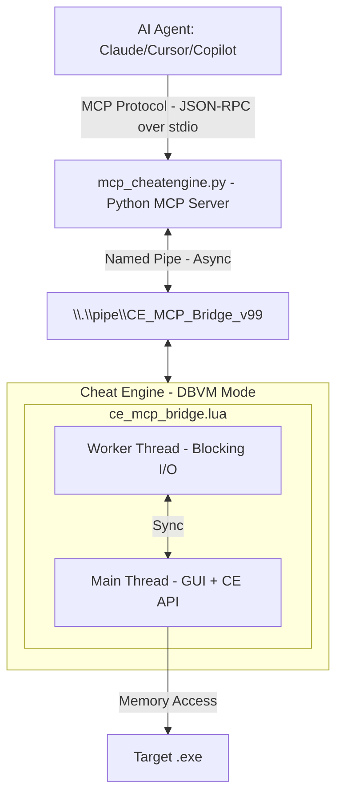

[Demo](https://github.com/user-attachments/assets/a184a006-f569-4b55-858a-ed80a7139035)

# Cheat Engine MCP Bridge

**Let multibillion $ AI datacenters analyze the program memory for you.**

Create mods, trainers, security audits, game bots, accelerate RE, or do anything else with any program and game in a fraction of a time.

[](#what-this-fork-changes) [](#) [](https://py.sdk.modelcontextprotocol.io/) [](https://python.org) [](https://github.com/Invalidity/cheatengine-mcp-bridge/actions/workflows/offline-tests.yml)

> [!IMPORTANT]
> **This is a maintained fork** of [miscusi-peek/cheatengine-mcp-bridge](https://github.com/miscusi-peek/cheatengine-mcp-bridge).
> It runs on the **MCP Python SDK 2.x**, integrates open upstream pull requests, and adds reliability, safety and test
> work on top. See [What this fork changes](#what-this-fork-changes). All credit for the original bridge goes to
> [@miscusi-peek](https://github.com/miscusi-peek) and the upstream contributors.

---

## What this fork changes

Compared with upstream `main` at [`6bd7ce9`](https://github.com/miscusi-peek/cheatengine-mcp-bridge/commit/6bd7ce90479250a9b4b75e7944df9c105ecb2572) (2026-08-14):

**MCP SDK 2.x and protocol features**
- Migrated from `FastMCP` (SDK 1.x) to `MCPServer` (SDK 2.x, `mcp>=2.3,<3`). Upstream still pins `mcp<2`.
- The Windows CRLF fix no longer monkey-patches the SDK: the server passes LF-only streams to the SDK's public
  `stdio_server(stdin, stdout)` parameters.
- **Tool annotations** on all 211 tools (`readOnlyHint`, `destructiveHint`, `idempotentHint`, `openWorldHint`),
  derived from the capability tiers: 119 read-only, 61 destructive, 31 additive. Clients can use them to auto-approve
  reads and confirm writes. `batch_commands` and unknown tools get the most cautious hints.
- **Server instructions** sent at connect time (unknown-outcome rule, one client per pipe, jobs for long scans).
- **Doc resources**: `cheatengine://docs/command-reference` and `cheatengine://docs/guide`.

**Integrated upstream pull requests** (authors credited in the commit history)
- [#65](https://github.com/miscusi-peek/cheatengine-mcp-bridge/pull/65) and [#67](https://github.com/miscusi-peek/cheatengine-mcp-bridge/pull/67)
  by [@fhjordskhkjel](https://github.com/fhjordskhkjel): async scan jobs, PE/RTTI/xref analysis, struct recovery,
  breakpoint control, two-run pointer path comparison, capability profiles, the offline test suites, and framing/JSON
  reliability fixes.
- Parts of [#66](https://github.com/miscusi-peek/cheatengine-mcp-bridge/pull/66) and all of
  [#71](https://github.com/miscusi-peek/cheatengine-mcp-bridge/pull/71) by
  [@397227196zyh-ops](https://github.com/397227196zyh-ops): breakpoint hit `count`, explicit `INVALID_ADDRESS`,
  corrected test documentation and the pipe-busy (error 231) explanation.

**Fixes and hardening**
- **No automatic retries, ever.** A failed or timed-out exchange has an *unknown* outcome; the client reports that
  instead of re-sending, so a write or code injection can never run twice. Calls are serialized on the one pipe.
- `ERROR_PIPE_BUSY` is handled while the bridge re-creates its pipe.
- Window handles accept `0x`-prefixed hex, bare hex and integers
  ([#69](https://github.com/miscusi-peek/cheatengine-mcp-bridge/issues/69)).
- Fractional float/double values are written as little-endian IEEE bytes
  ([#41](https://github.com/miscusi-peek/cheatengine-mcp-bridge/issues/41)).
- Auto Assembler script records (optional, created inactive, BOM stripped)
  ([#53](https://github.com/miscusi-peek/cheatengine-mcp-bridge/issues/53)).
- Offline regression tests for each fix, and CI that runs the Python suites.

**Not taken (yet)**
- [#68](https://github.com/miscusi-peek/cheatengine-mcp-bridge/pull/68) (patch journal with undo): its process identity
  check (PID plus optional name) can match a different process instance, so undo cannot rely on it as written.
- [#70](https://github.com/miscusi-peek/cheatengine-mcp-bridge/pull/70) (SDK 2.x): superseded by the migration above.
- [#63](https://github.com/miscusi-peek/cheatengine-mcp-bridge/issues/63) (disconnects during long zero-value scans):
  use `start_job` for long scans; a long live zero-value scan has not been tested.

### Verification status

| Check | Kind | Result |
|---|---|---|
| 15 offline suites (`tests/run_all.py`): real Lua bridge in CE's Lua 5.3 DLL against a fake CE API, Python client against a fake bridge on a real named pipe | Offline | All pass on SDK 2.3.0 |
| MCP stdio handshake: 211 tools with annotations, 2 resources, instructions, LF-only output | Offline | Pass |
| 64-bit CE tutorial: attach, modules, MZ header read, value scan, narrow, write and read back, tutorial accepts the change | Live, CE 7.7 | Passed with this bridge code on the SDK 1.x server; not yet repeated on the SDK 2.x server |

Offline tests prove the bridge and client logic, not Cheat Engine's real API. Debugger, DBVM, kernel and pointer-scan
tools have not been verified live in this fork.

---

## The Problem

You're staring at gigabytes of memory. Millions of addresses. Thousands of functions. Finding *that one pointer*, *that one structure* takes **days or weeks** of manual work.

**What if you could just ask?**

> *"Find the packet decryptor hook."*  
> *"Find the OPcode of character coordinates."*  
> *"Find the OPcode of health values."*  
> *"Find the unique AOB pattern to make my trainer reliable after game updates."*

**That's exactly what this does.**

_- Stop clicking through hex dumps and start having conversations with the memory._

---

## What You Get:

| Before (Manual) | After (AI Agent + MCP) |
|-----------------|---------------------|
| Day 1: Find packet address | Minute 1: "Find RX packet decryption hook" |
| Day 2: Trace what writes to it | Minute 3: "Generate unique AOB signature to make it update persistent" |
| Day 3: Find RX hook | Minute 6: "Find movement OPcodes" |
| Day 4: Document structure | Minute 10: "Create python interpreter of hex to plain text" |
| Day 5: Game updates, start over | **Done.** |

**Your AI can now:**
- Read any memory instantly (integers, floats, strings, pointers)
- Follow pointer chains: `[[base+0x10]+0x20]+0x8` → resolved in ms
- Auto-analyze structures with field types and values
- Identify C++ objects via RTTI: *"This is a CPlayer object"*
- Disassemble and analyze functions
- Debug invisibly with hardware breakpoints + Ring -1 hypervisor
- And much more!

---

## How It Works

---

## Installation

```bash
pip install -r MCP_Server/requirements.txt
```
Or manually:
```bash
pip install "mcp>=2.3,<3" pywin32
```

This fork needs the **MCP Python SDK 2.x**. If you installed upstream's requirements before, upgrade `mcp` (upstream
pins `mcp<2`). Use a virtual environment if other tools on the machine still need SDK 1.x.

> [!NOTE]
> Native pipe mode is **Windows only** because it uses Named Pipes (`pywin32`). Use TCP relay transport when the MCP server runs outside the Windows environment that hosts Cheat Engine and cannot open the named pipe directly.

---

## Quick Start

### 1. Load Bridge in Cheat Engine
1. Enable DBVM in Cheat Engine if you plan to use DBVM tools.
2. Open Cheat Engine's Lua Engine or script executor.
   - Preferred: `File` -> `Execute Script` -> open `MCP_Server/ce_mcp_bridge.lua` -> `Execute`.
   - If your Cheat Engine build does not show `File` -> `Execute Script`, use `Table` -> `Show Cheat Table Lua Script`, paste the `dofile(...)` line below, and execute it:

```lua
dofile([[C:\path\to\cheatengine-mcp-bridge\MCP_Server\ce_mcp_bridge.lua]])
```

Look for: `[MCP v12.0.0] MCP Server Listening on: CE_MCP_Bridge_v99`

To start the bridge automatically with Cheat Engine, put a one-line loader in CE's `autorun` folder (the path
`getAutorunPath()` returns, usually `C:\Program Files\Cheat Engine\autorun\`):

```lua
-- zz_mcp_bridge.lua
dofile([[C:\path\to\cheatengine-mcp-bridge\MCP_Server\ce_mcp_bridge.lua]])
```

### 2. Configure MCP Client
Add to your MCP configuration (e.g., `mcp_config.json`):
```json
{
  "servers": {
    "cheatengine": {
      "command": "python",
      "args": ["C:/path/to/MCP_Server/mcp_cheatengine.py"]
    }
  }
}
```
Restart the IDE to load the MCP server config.

For Claude Code, add it to the project's `.mcp.json` (or run `claude mcp add cheatengine -- python C:/path/to/MCP_Server/mcp_cheatengine.py`):

```json
{
  "mcpServers": {
    "cheatengine": {
      "command": "python",
      "args": ["C:/path/to/MCP_Server/mcp_cheatengine.py"],
      "env": { "CE_MCP_PROFILE": "analysis" }
    }
  }
}
```

For Codex, add a TOML server block to `~/.codex/config.toml`:

```toml
[mcp_servers.cheatengine]
command = "python"
args = ['C:\path\to\cheatengine-mcp-bridge\MCP_Server\mcp_cheatengine.py']
```

Use single quotes for the Windows path so TOML treats backslashes literally.

#### TCP relay transport

The TCP relay lets `mcp_cheatengine.py` talk to Cheat Engine through a TCP socket instead of opening the Windows named pipe itself. Cheat Engine and the Lua bridge still run on Windows, while the MCP server can run anywhere that can reach the relay: another Windows process, a VM, a container, a Linux host, or a remote machine. This can also be used with WSL without changing the Lua bridge.

1. On Windows, load `MCP_Server/ce_mcp_bridge.lua` in Cheat Engine as usual.
2. On Windows, start the relay:

```powershell
python C:\path\to\cheatengine-mcp-bridge\MCP_Server\ce_tcp_relay.py --host 127.0.0.1 --port 9876
```

3. In the environment where the MCP server will run, install the MCP dependency without `pywin32`, then run/configure the MCP server with TCP transport:

```bash
python3 -m pip install -r MCP_Server/requirements-tcp.txt
```

```bash
CE_MCP_TRANSPORT=tcp \
CE_MCP_HOST=127.0.0.1 \
CE_MCP_PORT=9876 \
python3 /path/to/cheatengine-mcp-bridge/MCP_Server/mcp_cheatengine.py
```

For MCP client configs that support environment variables:

```json
{
  "servers": {
    "cheatengine": {
      "command": "python3",
      "args": ["/path/to/cheatengine-mcp-bridge/MCP_Server/mcp_cheatengine.py"],
      "env": {
        "CE_MCP_TRANSPORT": "tcp",
        "CE_MCP_HOST": "127.0.0.1",
        "CE_MCP_PORT": "9876"
      }
    }
  }
}
```

Set `--host` on the relay and `CE_MCP_HOST` on the MCP server to addresses that match your network setup. Keep the relay bound to trusted interfaces only, because anyone who can reach it can control the Cheat Engine bridge.

### 3. Verify Connection
Use the `ping` tool to verify connectivity:
```json
{"success": true, "version": "12.0.0", "message": "CE MCP Bridge Active"}
```

### 4. Start Asking Questions
```
"What process is attached?"
"Read 16 bytes at the base address"
"Disassemble the entry point"
```

---

## 211 MCP Tools Available

Every tool carries MCP annotations (read-only, destructive, idempotent, open-world). The capability profile decides
which tools are listed and allowed; see [Safety controls](#safety-controls).

### Memory
| Tool | Description |
|------|-------------|
| `read_memory`, `read_integer`, `read_string` | Read any data type |
| `read_pointer_chain` | Follow `[[base+0x10]+0x20]` paths |
| `scan_all`, `aob_scan` | Find values and byte patterns |

### Analysis
| Tool | Description |
|------|-------------|
| `disassemble`, `analyze_function` | Code analysis |
| `dissect_structure` | Auto-detect fields and types |
| `get_rtti_classname` | Identify C++ object types |
| `find_references`, `find_call_references` | Cross-references |

### Debugging
| Tool | Description |
|------|-------------|
| `set_breakpoint`, `set_data_breakpoint` | Hardware breakpoints |
| `start_dbvm_watch` | Ring -1 invisible tracing |

### Process Lifecycle
| Tool | Description |
|------|-------------|
| `open_process`, `get_process_list` | Attach to or enumerate running processes |
| `create_process` | Launch a new process under CE's control |
| `pause_process`, `unpause_process` | Suspend / resume target execution |

### Memory Allocation
| Tool | Description |
|------|-------------|
| `allocate_memory`, `free_memory` | Reserve and release memory in the target |
| `set_memory_protection`, `full_access` | Adjust page protection flags |

### Code Injection
| Tool | Description |
|------|-------------|
| `inject_dll` | Load a DLL into the target process |
| `execute_code`, `execute_method` | Run shellcode or CE Lua methods remotely |

### Symbol Management
| Tool | Description |
|------|-------------|
| `register_symbol`, `get_symbol_info` | Create and query named symbols |
| `enable_windows_symbols` | Enable PDB symbol resolution |

### Assembly / Compilation
| Tool | Description |
|------|-------------|
| `assemble_instruction` | Assemble a single x86/x64 instruction to bytes |
| `compile_c_code` | Compile C source into injected shellcode |
| `generate_api_hook_script` | Generate a CE auto-assembler API hook template |

### Window / GUI Automation
| Tool | Description |
|------|-------------|
| `find_window` | Locate a window by title or class |
| `send_window_message` | Post `WM_*` messages to a target window |

### Input Automation
| Tool | Description |
|------|-------------|
| `get_pixel` | Sample a pixel color at screen coordinates |
| `is_key_pressed`, `do_key_press` | Query and simulate keyboard input |

### Cheat Table
| Tool | Description |
|------|-------------|
| `load_table`, `save_table` | Load / save `.CT` cheat table files |
| `get_address_list` | Enumerate entries in the active cheat table |

### Kernel Mode (DBK / DBVM)
| Tool | Description |
|------|-------------|
| `dbk_get_cr3` | Read the CR3 register for the target process |
| `read_process_memory_cr3` | Read physical memory via CR3 bypass |

### Jobs, analysis and pointer paths (from upstream PR #65)
| Tool | Description |
|------|-------------|
| `start_job`, `get_job`, `wait_for_job`, `get_job_result`, `cancel_job` | Long scans and searches without blocking CE or timing out |
| `pe_info`, `pe_imports`, `pe_exports`, `find_xrefs`, `find_string_refs` | PE parsing and cross-references straight from target memory |
| `recover_struct`, `rtti_scan_module` | RTTI-guided structure recovery |
| `find_pointer_path`, `compare_pointer_paths` | Find pointer chains, then keep the ones that survive a restart |
| `snapshot_region`, `diff_snapshots` | Before/after memory comparison |
| `bridge_status`, `policy_info`, `batch_commands` | Health, active profile, several commands in one round trip |

And many more at `AI_Context/MCP_Bridge_Command_Reference.md`, which is also served as the MCP resource
`cheatengine://docs/command-reference`.

---

## Safety controls

The bridge can write memory, run Lua, inject DLLs and execute code. Limit it to what the task needs.

| Profile (`CE_MCP_PROFILE`) | Allows |
|---|---|
| `readonly` | Observe only: reads, scans, disassembly, analysis |
| `analysis` | + breakpoints, symbols, structures, attaching, host introspection |
| `patch` | + memory, register and protection writes, allocations |
| `full` (default) | + code execution, injection, shell, files, input automation |

- `CE_MCP_ALLOW` / `CE_MCP_DENY` lift or remove single tools (deny wins). `CE_MCP_TOOLSET` (`minimal`, `reverse`, or a
  list of groups) shrinks the tool list to save model context.
- The profile is enforced in the client for every call, including the requests inside `batch_commands` and the kind
  passed to `start_job`. An unknown profile name fails closed to `readonly`.
- `run_command` and `shell_execute` stay disabled unless `CE_MCP_ALLOW_SHELL=1`.
- Tool annotations are hints for the client's approval UI; the profile is the enforcement.
- The named pipe is local to the machine. The optional TCP relay has **no authentication**: bind it to trusted
  interfaces only.

---

## Critical Configuration

### BSOD Prevention
> [!CAUTION]
> **You MUST disable:** Cheat Engine → Settings → Extra → **"Query memory region routines"**
>
> Enabled: Causes `CLOCK_WATCHDOG_TIMEOUT` BSODs due to conflicts with DBVM/Anti-Cheat when scanning protected pages.

---

## Troubleshooting

### Cheat Engine says "too many local variables"

Load the bridge from disk with `dofile(...)` instead of pasting the full script into a cheat table script. The bridge also declares command handlers as global functions intentionally; this avoids Cheat Engine's Lua chunk limit of 200 local variables when the complete bridge is compiled at once.

### MCP client cannot connect

Check these in order:

1. Cheat Engine is open and shows `MCP Server Listening on: CE_MCP_Bridge_v99`.
2. The MCP client was restarted after adding the server config.
3. The configured `mcp_cheatengine.py` path exists.
4. `pip install -r MCP_Server/requirements.txt` has installed both `mcp` and `pywin32`.
5. Run the MCP `ping` tool. A successful connection returns `success: true` and the bridge version. `process_id: 0` is normal until Cheat Engine is attached to a target process.

### `No module named 'mcp.server.fastmcp'` or `No module named 'mcp.server.mcpserver'`

The first means an old copy of the server is running against SDK 2.x; the second means this fork's server is running
against SDK 1.x. Install this fork's `MCP_Server/requirements.txt` into the Python that your MCP client launches.

### A call failed and says its outcome is unknown

The request may have reached Cheat Engine and run. The server never retries on its own. Check the target (read the
memory, `list_breakpoints`, `list_jobs`) before repeating anything that writes.

### `test_mcp.py` fails with `(231, 'CreateFile', ...)`

Windows error 231 is `ERROR_PIPE_BUSY`: every instance of the Named Pipe is already in use.

The bridge serves **one client at a time**, so this is the normal outcome when an MCP client is connected while you run the test suite — not a broken install. Stop or disconnect the MCP client, then run the suite again. Waiting will not help: the existing client holds the only instance, so a second one has nothing to connect to however long it waits.

---

## Environment Variables

| Variable | Default | Purpose |
|----------|---------|---------|
| `CE_MCP_TIMEOUT` | `30` | Timeout (seconds) for each MCP tool call; `0` or less disables it. Keep it below the MCP client's own tool timeout. |
| `CE_MCP_CONNECT_WAIT` | `2` | Seconds to keep trying a busy or re-created pipe before failing. |
| `CE_MCP_PROFILE` | `full` | Capability profile: `readonly`, `analysis`, `patch`, `full`. |
| `CE_MCP_ALLOW` / `CE_MCP_DENY` | *unset* | Comma-separated tool names to add to / remove from the profile. |
| `CE_MCP_TOOLSET` | all | `minimal`, `reverse`, or comma-separated groups to list fewer tools. |
| `CE_MCP_TRANSPORT` | `pipe` | `tcp` to use the TCP relay (`CE_MCP_HOST`, default `127.0.0.1`; `CE_MCP_PORT`, default `9876`). |
| `CE_MCP_ALLOW_SHELL` | *unset* | Set to `1` to enable `run_command` / `shell_execute` tools. **Arbitrary code execution risk** — leave unset by default. |

---

## Example Workflows

**Finding a value:**
```
You: "Scan for gold: 15000"  →  AI finds 47 results
You: "Gold changed to 15100"  →  AI filters to 3 addresses
You: "What writes to the first one?"  →  AI sets hardware BP
You: "Disassemble that function"  →  Full AddGold logic revealed
```

**Understanding a structure:**
```
You: "What's at [[game.exe+0x1234]+0x10]?"
AI: "RTTI: CPlayerInventory"
AI: "0x00=vtable, 0x08=itemCount(int), 0x10=itemArray(ptr)..."
```

---

## Project Structure

```
AGENTS.md, CLAUDE.md                    # Agent guidance (Codex / Claude Code)
README.md                               # User-facing documentation

MCP_Server/
├── mcp_cheatengine.py                  # Python MCP server (SDK 2.x MCPServer)
├── tool_policy.py                      # Capability profiles, tool groups, tool annotations
├── ce_mcp_bridge.lua                   # Cheat Engine Lua bridge
├── ce_tcp_relay.py                     # Optional TCP relay for non-Windows MCP hosts
└── test_mcp.py                         # Live end-to-end suite

tests/                                  # Offline suites (no Cheat Engine needed) + live smoke test
AI_Context/
├── MCP_Bridge_Command_Reference.md     # Command reference (also an MCP resource)
├── AI_Guide_MCP_Server_Implementation.md  # Architecture and usage guide (also an MCP resource)
├── CE_LUA_Documentation.md             # Cheat Engine Lua API reference
└── Pointer_Tools_*.md                  # Pointer tool design notes
```

---

## Testing

### Offline suites (no Cheat Engine needed)

```bash
python tests/run_all.py              # all 15 suites, about 60 s
python tests/run_all.py --real       # + PE/RTTI parsing against real system DLLs
python tests/run_all.py --mutation   # + check that the suites catch deliberate breakages
```

They run the real Lua bridge inside Cheat Engine's own `lua53-64.dll` against a fake CE API, and the Python client
against a fake bridge on a real named pipe. Without the CE DLL the Lua suites are skipped, not failed. CI runs the
Python suites on every push. See [`tests/README.md`](tests/README.md).

### Live end-to-end suite

`test_mcp.py` is an end-to-end script that drives the live bridge over the Named
Pipe. It is not a unit-test harness: every case sends a real command, and several
of them write to the target process.

Preconditions:

1. Cheat Engine is open with `ce_mcp_bridge.lua` loaded.
2. A target process is attached. The write, breakpoint and allocation cases need
   one; without it they fail or cascade-skip.
3. **No MCP client is connected.** The bridge serves one client at a time, so a
   running AI client holds the only pipe instance and the suite cannot open it.
   Stop or disconnect the client first.

```bash
python MCP_Server/test_mcp.py
```

The suite registers 67 cases (`all_tests` in `test_mcp.py`) and prints a
per-category tally, then a summary in this shape:

```
======================================================================
TOTAL: <passed> passed, <failed> failed, <skipped> skipped (of <total>)
PASS RATE: <n>% (excluding skipped)
======================================================================
```

Exit status is non-zero when any case failed. The exact numbers depend on the
target architecture and on whether DBVM is loaded, so there is no single expected
transcript: the case list and the categories are defined in `test_mcp.py`.

---

## Credits

- Original bridge: [@miscusi-peek](https://github.com/miscusi-peek) and the upstream contributors
  [@libangli218](https://github.com/libangli218), [@lauralex](https://github.com/lauralex),
  [@iamtyroon](https://github.com/iamtyroon), [@HachiroSan](https://github.com/HachiroSan),
  [@Attacktive](https://github.com/Attacktive).
- Integrated pull requests: [@fhjordskhkjel](https://github.com/fhjordskhkjel) (#65, #67) and
  [@397227196zyh-ops](https://github.com/397227196zyh-ops) (#66, #71).
- Licensed under MIT; see [LICENSE](LICENSE). The upstream copyright notice is kept.

---

## The Bottom Line

You no longer need to be an expert. Just ask the right questions.

⚠️ EDUCATIONAL DISCLAIMER

This code is for educational and research purposes only. It's created to show the capabilities of the Model Context Protocol (MCP) and LLM-based debugging. I do not condone the use of these tools for malicious hacking, cheating in multiplayer games, or violating Terms of Service. This is a demonstration of software engineering automation.
