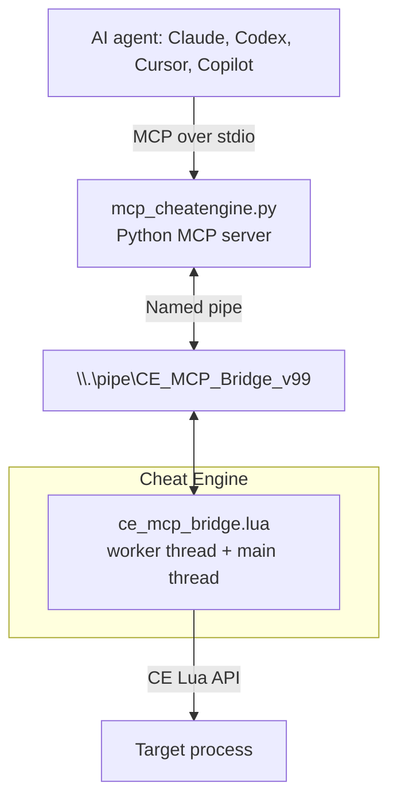

# Cheat Engine MCP Bridge

**Let an AI agent work with Cheat Engine for you.** Ask in plain language; the agent reads memory, scans, follows
pointers, disassembles code and sets breakpoints through Cheat Engine.

> [!NOTE]
> A fork of [miscusi-peek/cheatengine-mcp-bridge](https://github.com/miscusi-peek/cheatengine-mcp-bridge), updated
> for MCP SDK 2.x with safety and reliability fixes. [What changed →](https://github.com/Invalidity/cheatengine-mcp-bridge/wiki/Fork-Changes)

## What you can ask

- *"Which instruction writes to my health value?"*
- *"Make an AOB signature that survives the next game update."*
- *"What C++ class is the object at this address?"*
- *"Find a pointer path to gold that still works after a restart."*

## Quick start

You need Windows, Cheat Engine 7.x and Python 3.10+.

1. **Install:** `pip install -r MCP_Server/requirements.txt`
2. **Load the bridge:** in Cheat Engine, **File → Execute Script** → `MCP_Server/ce_mcp_bridge.lua`
3. **Connect your client**, for example Claude Code:
   `claude mcp add cheatengine -- python C:/path/to/MCP_Server/mcp_cheatengine.py`
4. **Check it:** ask the agent to call `ping`.

> [!CAUTION]
> In Cheat Engine, turn off **Settings → Extra → "Query memory region routines"**. With it on, scans can crash Windows.

## How it works

1. **Your AI client** starts the Python server and talks to it over MCP.
2. **The Python server** turns each tool call into a command and sends it down a named pipe.
3. **The Lua bridge** runs inside Cheat Engine, carries out the command and sends back the result.

## Documentation

Everything else lives in the **[wiki](https://github.com/Invalidity/cheatengine-mcp-bridge/wiki)**:

| | |
|---|---|
| [Installation](https://github.com/Invalidity/cheatengine-mcp-bridge/wiki/Installation) | Setup, autorun |
| [Connecting a client](https://github.com/Invalidity/cheatengine-mcp-bridge/wiki/Connecting-a-Client) | Claude Code, Codex, VS Code, Cursor, TCP relay |
| [Tools](https://github.com/Invalidity/cheatengine-mcp-bridge/wiki/Tools) | The 211 tools, grouped by task |
| [Safety and settings](https://github.com/Invalidity/cheatengine-mcp-bridge/wiki/Safety-and-Settings) | Profiles and environment variables |
| [Troubleshooting](https://github.com/Invalidity/cheatengine-mcp-bridge/wiki/Troubleshooting) | Common problems |
| [Testing](https://github.com/Invalidity/cheatengine-mcp-bridge/wiki/Testing) | Test suites and latest results |
| [Unity: Mono and IL2CPP](https://github.com/Invalidity/cheatengine-mcp-bridge/wiki/Unity-Mono-and-IL2CPP) · [Godot 4](https://github.com/Invalidity/cheatengine-mcp-bridge/wiki/Godot-4) | Engine notes from real use |

Full tool reference: [`AI_Context/MCP_Bridge_Command_Reference.md`](AI_Context/MCP_Bridge_Command_Reference.md).

## Credits

Original project by [@miscusi-peek](https://github.com/miscusi-peek) and contributors. Includes pull requests by
[@fhjordskhkjel](https://github.com/fhjordskhkjel) and [@397227196zyh-ops](https://github.com/397227196zyh-ops).
MIT licensed; see [LICENSE](LICENSE).

**Use it only on software you own or may modify.** Don't use it to cheat in online games or break terms of service.
